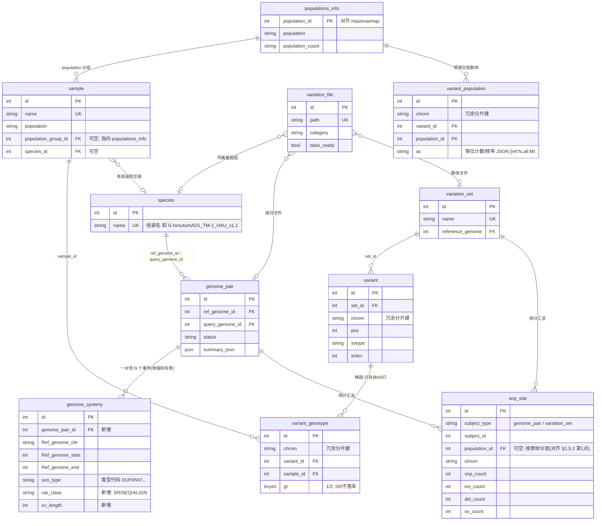

# CottonOGD 基因组结构变异（Genome SV）数据存储设计说明

> 状态：**设计稿（未建表）** · 日期：2026-11-13 · 依据：SoybeanGDB 源码（`/data/web/CottonOGD/SoybeanGDB`）、**maizevarmap 源码**（`/data/web/CottonOGD/maize_db-main/backend/maizevarmap`）、本项目测试数据（`backend/data/genome_SV/test/`）、现有后端（Django 5.2 + MySQL `cottonogd-ortho`）

---

## 1. 我们的数据是什么：SyRI 成对基因组比较

结构变异（SV）数据由 `Script/script/SV/SV.sh` 管线产生：

```
pre_fasta.R（过滤 scaffold、排序染色体）
  → minimap2 -ax asm5 --eqx（参考基因组 × 查询基因组）
  → samtools sort
  → syri -F B
```

每个"参考基因组 × 查询基因组"一对，产出一组文件（以 test 目录 TM-1 × Jin668 单条染色体 A01 为例）：

| 文件 | 内容 | test 实测规模 |
|---|---|---|
| `syri.out` | 全部变异 + 注释，12 列 tab 分隔 | 181,736 行 |
| `syri.vcf` | 同上内容的 VCF 编码 | 181,601 条 |
| `sv.txt` | 仅序列级注释（HDR/INS/DEL/CPG/CPL/TDM），含序列 | 856 行 |
| `snps.txt` | SNP/短 Indel | 59 MB |
| `syri.summary` | 分类型统计（数量、ref/query 长度） | 汇总表 |
| `dupOut/invOut/synOut/TLOut/...` | 各类型 bed 区间中间文件 | 小 |

**关键比例**（单染色体实测，`syri.summary` 权威口径）：181,601 条记录里，结构重排（SR）只有 **170 条**，序列级注释 856 条，其余 **99.3% 是 SNP/短 Indel**（SNP 103,128 + 插入 63,849 + 缺失 12,457）。**这个比例决定了存储策略：结构变异入库，短变异留文件层。**

### 1.1 syri.out 逐列说明（这就是"SoybeanGDB 格式"的真身）

```
Ghir_A01  1  5392  -      -  Ghjin_A01  119653645  119659034  DUP100  -    DUP  copygain
Ghir_A01  379 380 TA     T      Ghjin_A01  4024      4024       DEL858  SYN1 DEL  -
```

| 列 | 含义 | 示例 |
|---|---|---|
| 1 | 参考基因组染色体 | `Ghir_A01` |
| 2–3 | 参考基因组起止 | `1` `5392` |
| 4 | 参考等位/序列（结构变异为 `-`） | `TA` |
| 5 | 查询等位/序列（插入序列在这里） | `T` |
| 6 | 查询基因组染色体 | `Ghjin_A01` |
| 7–8 | 查询基因组起止 | `119653645` `119659034` |
| 9 | 事件 ID | `DUP100` |
| 10 | 父事件 ID（所属同源/重排块，`-` 为无） | `SYN1` |
| 11 | **类型代码**（下表） | `DUP` |
| 12 | copygain/copyloss（仅 DUP 类） | `copygain` |

### 1.2 类型代码语义（syri.vcf `##ALT` 声明）

分三类（建表时用于打 `var_class` 标签）：

| 类 | 代码 | 含义 |
|---|---|---|
| **结构重排 SR** | `SYN` `INV` `TRANS` `INVTR` `DUP` `INVDP` | 共线性块、倒位、易位、倒位易位、重复、倒位置复 |
| **序列级注释** | `INS` `DEL` `CPG` `CPL` `HDR` `TDM` | 插入、缺失、拷贝增加/丢失、高分化区、串联重复 |
| **对齐注释（非变异）** | `*AL`（SYNAL/INVAL/TRANSAL/INVTRAL/DUPAL/INVDPAL）、`NOTAL` | 支撑上层 SR 的比对区段、未比对区段 |
| 短变异 ShV | `SNP`、短 `DEL/INS`（REF/ALT 为具体碱基） | 不入库，见 §4.4 |

---

## 2. SoybeanGDB 是怎么存的（对照解析）

SoybeanGDB 是 **R Shiny 应用，没有数据库**。所有数据是平面文件，三套方案并存：

| 数据 | SoybeanGDB 存储 | 查询方式 | 局限 |
|---|---|---|---|
| 成对 SV | `info/genestructurevariation/{DUP,INV,TDM,TRANS,DEL,INS}/` 下每个 (参考×查询×类型) 一个 gz TSV，内容即 SyRI 输出（2 参考基因组 × ~30 查询基因组 × 6 类型 ≈ 60 文件/类型） | 每次查询**整文件读入内存**，再按染色体字符串过滤 | 无索引、无跨对统计、无频率，文件数随基因组对数平方增长 |
| 群体 SNP（2898 材） | 按 5Mb bin 切块的 R 稀疏矩阵（`Matrix::sparseMatrix`，0/1/2 编码 + 等位矩阵），xz 压缩 RData | 载入区间 bin 后内存过滤 + 在线 MAF 过滤 | 与 Web 后端异构（R 私有格式），无法 SQL 查询 |
| 群体小 Indel | `indel/chr*.delete.gz` 宽表 tabix 文件：`CHROM POS REF ALT` + 每样本一列（单元格=等位串，`N`=缺失） | tabix 区间取回后按样本列切片 | 2898 列宽表，加样本要重写全文件 |

**要借鉴的思想**：① SV 记录沿用 SyRI 输出的字段结构（我们已有）；② 群体基因型用"变异 × 样本"矩阵 + **稀疏编码（只存非参考）**。
**要避免的坑**：平面文件无索引无统计、整文件入内存、宽表加样本需重写、R 私有格式与 Django 后端割裂。CottonOGD 已有 MySQL + Django，直接落库补齐索引与统计即可全面超越该方案。

---

## 2.5 项目内可借鉴的成熟范式：maizevarmap（maize_db-main）

同一个仓库下的玉米变异数据库 `maizevarmap`（`/data/web/CottonOGD/maize_db-main/backend/maizevarmap/models.py`）已经实现了一套**群体 SNP/Indel 的稀疏存储 + 群体级聚合**，是我们要落地的 B 域/C 域的直接参考样板。它**没有专门的 SV 表**——把缺失在展示时替换成 `<DEL>` 当作 indel 处理（`variant_detail.py:127`），但我们棉花有真正的 SyRI 成对 SV，需单列一域（§4.1），群体层面则沿用下面的范式。

### 2.5.1 它的表结构（精炼）

| 表 | 角色 | 关键字段 / 约束 |
|---|---|---|
| `samples` | 样本维表 | `sample_id PK, sample_name, population, population_group, source_id, country, latitude, longitude, species, accession_id` |
| `populations_info` | 群体维表 | `population_id PK, population, population_count` |
| `snp_variants` / `indel_variants` | 位点主表 | `chr, variant_id PK, show_id, pos, ref, alt, ac`；**snp 的 ref/alt 短（VARCHAR 1/4），indel 的 ref/alt 用 TextField 存长序列**（区分好） |
| `snp_genotypes` / `indel_genotypes` | **稀疏基因型表** | `chr, sample_id, variant_id, genotype(0/1/2)`，`unique_together(sample_id, variant_id)`，只存有效基因型 |
| `snp_populations` / `indel_populations` | **群体级 AC 预聚合表** | `chr, variant_id PK, population_id FK, ac`，`unique_together(variant_id, population)` —— 频率/携带数不再每次扫基因型表 |

### 2.5.2 三个值得直接采纳的设计点

1. **群体级 AC 预聚合表**：这是我们的 `snp_stat` 必须升级的地方。maizevarmap 不靠 `COUNT(GROUP BY)` 实时算频率，而是预存 `snp_populations.ac`（每个群体每个位点的等位计数），查询走 `select_related('population')` 直接出群体频率。对应我们：B 域应新增 `variant_population`（按群体聚合 AC/携带数），C 域的 `snp_stat` 也从"一对计数"升级为"**按群体/样本分层**"的统计，而不是只存全库总数。
2. **`chr` 冗余到所有子表做分片键**：`samples` 之外的每个表都带 `chr` 字段，区间查询统一走 `(chr, pos/variant_id)` 复合索引。这是为了在千万~亿级行上让区间查询保持单表/单分片的确定性。**我们的 `variant_genotype` 也应冗余 `chr`（或 `set_id`）+ 用 `(chr, variant_id)` / `(chr, sample_id)` 索引**，而不是只靠跨表 JOIN。
3. **SNP/Indel 字段宽度区分**：snp 的 ref/alt 用定长短字符串（节省空间，亿级行显著），indel 才用 TEXT。我们的 `variant.ref/alt` 据此对短变异用 VARCHAR、符号等位（`<DEL>`）与长插入序列才用 TEXT。

### 2.5.3 查询范式（可直接套用）

- 区间：`SnpVariants.objects.filter(chr=chr_name, pos__gte=start, pos__lte=end)`（`vars_in_region.py` / `vars_in_gene.py`）
- 群体频率：`*_populations.objects.select_related('population').filter(chr, variant_id, population_id__in=[...])`
- 某样本基因型：`*_genotypes.objects.filter(chr, variant_id, sample_id__in=[...])`（`vars_genotype.py`）
- 密度/可视化：预生成 `snp_density.json` / `indel_density.json` 静态文件直读，不全库聚合（`baseinfo.py::get_density_data`）——对应我们的"分 bin 密度走静态/统计表而非实时聚合"。
- 样本分层：`Samples.population` + `population_group`（野生/地方种/栽培种）与我们的 `sample.group` 完全同构。

**结论**：B 域群体 VCF 表结构基本就是 maizevarmap 的 `*_variants + *_genotypes + *_populations` 三件套换成通用 `variant/variant_genotype/variant_population`，并把"参考基因组 × 查询基因组"维度用 `set_id` 表达（maizevarmap 是单参考 B73，我们是多参考多数据集，故多一层 `variation_set`）。

---

## 3. 稀疏矩阵：为什么必须稀疏，怎么表达

### 3.1 天然稀疏

把"变异 × 携带它的基因组/样本"画成矩阵，每个 SV 只存在于少数材料中：

```
              TM-1  Jin668  3-79  ... (260 基因组 / N 样本)
DUP100         .      1      .
INV7           .      1      1
DEL858         .      1      .
SYN1           1      1      1     ← 共线性块几乎全存在（矩阵中最"稠密"的部分）
  ... 数百万行
```

- **宽表**（每基因组一列）：260+ 列、>99% 单元格为空，加一个基因组要 `ALTER TABLE` 加列——不可行。SoybeanGDB 的 Indel 宽表正是这个教训。
- **长表/稀疏**：只存"存在的格子" `(variant_id, sample_id)`，加样本=维表插一行，加变异=主表插一行。

### 3.2 项目内已有同构先例

`gene_expression`（models.py:101）就是长表稀疏：`(geneid, genome, tissue, stage, value)`。SV 的 `(variant, sample)` 与之同构，团队心智模型一致。

### 3.3 编码约定（沿用 SoybeanGDB 的 0/1/2 稀疏编码）

| 基因型 | 编码 | 是否落库 |
|---|---|---|
| 纯合参考 0/0 | 0 | **不存**（由"样本总数 − 已存行"隐含） |
| 杂合 0/1 | 1 | 存 |
| 纯合变异 1/1 | 2 | 存 |
| 缺失 ./. | NULL/不存 | 不存 |
| 拷贝数（CNV 类，可选） | `copy_number` 数值列 | 有则存 |

频率/携带数按需 `COUNT/GROUP BY` 现算，或预聚合成 §4.4 的统计表。

---

## 4. 建表规划（三个数据域 + 一个文件台账）

### 4.0 总览

| 域 | 数据 | 规模（全库估算） | 存储 |
|---|---|---|---|
| A. 成对 SV | SyRI 结构重排 + 序列级注释 | 每对 ~2 万条 × 259 对 ≈ **500 万行** | MySQL（复用 `genome_synteny`） |
| B. 群体 multi-sample SV VCF | 变异位点 × 样本基因型 | 位点 ~50 万 × 样本 260+，非参考率 ~20% ≈ **数千万行** | MySQL 稀疏三表 |
| C. 短变异（SNP/Indel） | 十亿级明细 | ~340 万条/对 × 259 对 ≈ **8~9 亿行** | **不进库**：`.vcf.gz`+tabix 文件 + 统计汇总表 |

> 量级推算依据：test 单染色体（A01，117.8 Mb）× 全基因组约 19 个 A01 当量（TM-1 ≈ 2.2 Gb）× 259 个查询基因组。

### 4.1 A 域：成对结构变异（增强现有表）

**新增维表 `genome_pair`**（比对批次管理，幂等重跑的锚点）：

| 字段 | 类型 | 说明 |
|---|---|---|
| id | BIGINT PK | |
| ref_genome_id | INT | → `species.id`（沿用整数引用惯例，非硬 FK） |
| query_genome_id | INT | → `species.id`；`UNIQUE(ref_genome_id, query_genome_id)` |
| minimap2_params | VARCHAR(255) | `asm5 --eqx` 等 |
| syri_version | VARCHAR(50) | |
| status | VARCHAR(20) | running / imported / verified / retired |
| summary_json | JSON | `syri.summary` 全文结构化（分类型计数/长度） |
| created_at / updated_at | DATETIME | |

**增强现有 `genome_synteny`**（models.py:341，字段保留、不推翻）：

| 改动 | 内容 | 理由 |
|---|---|---|
| 加复合索引 | `(Ref_genome, Query_genome, Ref_genome_chr, son_type)` | 现有视图 `genome_api.genome_synteny` 的过滤组合，当前全表扫 |
| 加索引 | `(Query_genome_chr)`、`(pair → genome_pair_id)` | 反向查询、按批次管理 |
| 加列 `var_class` | TINYINT/VARCHAR：SR / SEQ / ALIGN | `son_type` 里混着对齐注释（SYNAL/NOTAL…），现在无法低成本只取真实变异 |
| 加列 `sv_length` | INT，导入时算 `end-start+1` | 长度分布、按长度筛选用 |
| `Ref_seq/Alt_seq` 收敛 | 序列注释行的长序列截断（如 >10 kb 只存前 1 kb + 全长标记），或后续移到独立序列表 | `sv.txt` 里 HDR 带几十 kb 序列，防表膨胀 |
| 加列 `genome_pair_id` | INT → genome_pair.id | 新数据带批次；旧数据可 NULL 兼容 |
| 语义澄清 | `Variation_type` 现存 SyRI **事件 ID**（DUP100），`son_type` 存**类型代码**（DUP）——文档化，不改名避免破坏现有 API | 现状即如此 |

### 4.2 B 域：群体 multi-sample VCF（真正的稀疏矩阵，全新表）

**范式来源**：本仓库 `maizevarmap` 的 `*_variants + *_genotypes + *_populations` 三件套（见 §2.5），此处推广为通用 `variant + variant_genotype + variant_population`，并把单参考（B73）升级为 `variation_set`（多参考/多数据集）。

五表结构：

**`variation_set`** — 一次群体 calling 的数据集

| 字段 | 类型 | 说明 |
|---|---|---|
| id | BIGINT PK | |
| name | VARCHAR(100) UNIQUE | 如 `cotton_pan_sv_v1` |
| reference_genome | INT | → species.id（对应 maizevarmap 固定用 B73 的隐含参考） |
| caller | VARCHAR(100) | calling 工具与版本 |
| sample_count | INT | 冗余，便于展示 |
| version / created_at | | |

**`sample`** — 样本维表（矩阵的"列"，对齐 maizevarmap `samples` + `populations_info`）

| 字段 | 类型 | 说明 |
|---|---|---|
| id | INT PK | |
| name | VARCHAR(100) UNIQUE | VCF 表头样本名 |
| population / population_group_id | VARCHAR / INT FK→populations_info | 群体名 + 亚组（野生种/地方种/栽培种，对齐 maizevarmap 同名字段，亚组走维表便于聚合） |
| species_id | INT 可空 | 若该材料同时有组装（在 `species` 表），互链 |
| source / country / lat / lon | VARCHAR/DECIMAL 可空 | 材料来源与地理（maizevarmap 经验：地理维度很常用） |
| accession_id | VARCHAR 可空 | 原始材料编号 |

**`variant`** — 位点主表（矩阵的"行"，对齐 maizevarmap `*_variants`）

| 字段 | 类型 | 说明 |
|---|---|---|
| id | BIGINT PK | |
| set_id | BIGINT | → variation_set.id |
| chrom | VARCHAR(50) | **冗余到子表做分片键**（§2.5.2 第 2 点） |
| pos / end_pos | INT | |
| show_id | VARCHAR(20) | 展示用稳定 ID，如 `mzs0001...`（对齐 maizevarmap `show_id`） |
| svtype | VARCHAR(20) | DEL/INS/DUP/INV/BND/CNV… |
| svlen | INT | 可负 |
| ref / alt | **短变异 VARCHAR(1/4)，符号等位 `<DEL>` 与长插入序列用 TEXT**（对齐 §2.5.2 第 3 点，亿级行省空间） |
| qual / filter | FLOAT / VARCHAR(20) | |
| info_json | JSON 可空 | 保留原始 INFO 备查 |
| 索引 | `(set_id, chrom, pos)`、`(set_id, svtype)`、`UNIQUE(set_id, chrom, pos, svtype, alt(100))` | 区间查、类型筛、防重导 |

**`variant_genotype`** — 稀疏关联表（只存非 0/0 的格子，对齐 maizevarmap `*_genotypes`）

| 字段 | 类型 | 说明 |
|---|---|---|
| id | BIGINT PK | |
| chrom | VARCHAR(50) | **冗余分片键**（§2.5.2 第 2 点） |
| variant_id | BIGINT | → variant.id |
| sample_id | INT | → sample.id |
| gt | TINYINT | 1=杂合 2=纯合变异（0/0 不落库） |
| copy_number | FLOAT 可空 | CNV 类可选 |
| 索引 | `UNIQUE(chrom, variant_id, sample_id)`、`(chrom, sample_id)` | 防重、支持"某样本全部变异"反向查询，均含分片键 |

**`variant_population`** — **群体级 AC 预聚合表**（对齐 maizevarmap `*_populations`，§2.5.2 第 1 点）

| 字段 | 类型 | 说明 |
|---|---|---|
| id | BIGINT PK | |
| chrom | VARCHAR(50) | 冗余分片键 |
| variant_id | BIGINT | → variant.id |
| population_id | INT | →（可选）群体维表，或存 population_group 字符串 |
| ac | VARCHAR(40) | 等位计数/频率 JSON（如 `{"ref":N1,"alt":N2}`），对应 maizevarmap 的 `ac` |
| 索引 | `UNIQUE(chrom, variant_id, population_id)`、`(chrom, variant_id)` | 频率查询免扫基因型表 |

> 为什么必须有 `variant_population`：群体频率（如"栽培种中该 SV 携带率"）是页面高频查询。没有它，每次都要 `variant_genotype` 全表 `COUNT GROUP BY`（千万行，慢且烧 IO）；maizevarmap 正是用 `*_populations` 把这一步预聚合掉。我们的 `snp_stat`（§4.3）同理应从"一对总数"升级为"按群体/样本分层"。

### 4.3 C 域：短变异文件层 + 统计汇总

明细永不进 MySQL（9 亿行的导入/备份/索引成本失控）。落两层：

**`variation_file`** — 文件台账（全库变异类文件的唯一登记处，数据管理抓手）

| 字段 | 类型 | 说明 |
|---|---|---|
| id | BIGINT PK | |
| path | VARCHAR(500) UNIQUE | 相对 `backend/data/` 的路径 |
| category | VARCHAR(30) | syri.out / syri.vcf.gz / snps.vcf.gz / pop_vcf |
| ref_genome / query_genome | INT 可空 | 成对文件填 |
| set_id | BIGINT 可空 | 群体文件填 |
| tabix_ready | BOOL | 是否已 `bgzip -i` + `tabix`（JBrowse 可用） |
| md5 / size | | 完整性 |
| status | VARCHAR(20) | pending / indexed / imported / failed |
| imported_at | DATETIME | |

**`snp_stat`** — 统计汇总（页面展示用，永远 <10 万行）

| 字段 | 说明 |
|---|---|
| subject_type + subject_id | genome_pair 或 variation_set |
| chrom | 染色体（或 `all`） |
| snp_count / ins_count / del_count / sv_count | 计数，来源 `syri.summary` / `bcftools stats` |
| density_json 可空 | 分 bin 密度（JBrowse histogram 直读） |

### 4.4 ER 关系图



> ER 图中 B 域 `variant / variant_genotype / variant_population` 三表即 §2.5 maizevarmap 范式（`*_variants + *_genotypes + *_populations`）的推广：通用化 variant 表 + 冗余 `chrom` 分片键 + 群体级 AC 预聚合。此外每表 `chrom` 冗余列对应 §2.5.2 第 2 点、短变异 ref/alt 用 VARCHAR 长序列用 TEXT 对应第 3 点。

**边界一句话**：A/B 域明细在库内（稀疏），短变异明细在库外（tabix 文件），`variation_file` 台账把两边缝起来。

---

## 5. 导入管线设计（对齐项目既有惯例）

### 5.1 成对 SV：syri.out → genome_synteny

- 新 Python 导入脚本（替代现有 `Genome_Variation.R` 的 RMySQL 直灌），沿用 `backend/scripts/import/uniprot_import_all.py` 的 **TSV + `LOAD DATA LOCAL INFILE`** 快路径（settings 已开 `local_infile=True`）。
- 步骤：解析 `syri.out` 12 列 → 过滤 ShV（REF/ALT 为具体碱基的 SNP/短 Indel 行）→ 按 §1.2 打 `var_class` → 算 `sv_length`、长序列截断 → 落 TSV → LOAD DATA。
- **幂等**：先 `INSERT/UPDATE genome_pair(status='running')` → `DELETE FROM genome_synteny WHERE genome_pair_id=?`（旧数据按 Ref/Query 双字段兼容删除）→ 导入 → 校验 → `status='verified'`。重跑一对不影响其他对。

### 5.2 群体 VCF：multi-sample VCF → 稀疏三表

- Python 流式解析 VCF（不整文件入内存）：先写 `variation_set`/`sample`（样本列序 → sample.id 映射表），变异行批量 LOAD DATA 进 `variant`，基因型行按 GT 映射（`0|0`跳过，`0|1`→1，`1|1`→2，`./.`跳过）只保留非 0/0 格子 LOAD DATA 进 `variant_genotype`。
- **校验**：导入行数 vs `bcftools index -n`；每染色体抽样 1000 位点回读比对 GT；`UNIQUE` 约束兜底防重导。

### 5.3 SNP 文件层

`bgzip + tabix` 建索引 → 登记 `variation_file(tabix_ready=true)` → `bcftools stats`（或解析 `syri.summary`）写 `snp_stat`。JBrowse 经现有 `serve_large_file`（`jbrowes_file.py`，白名单已含 `.vcf.gz`）直接流式提供，零入库成本。

---

## 6. 后期数据管理约定

1. **命名规范**：`backend/data/genome_SV/{Ref}_vs_{Query}/` 下统一 `syri.out / syri.vcf.gz / syri.summary / snps.vcf.gz`；群体数据 `backend/data/population/{set_name}/{set_name}.chr{N}.vcf.gz`（按染色体切分，控制单文件体积、支持并行导入）。
2. **台账即真相**：任何变异类文件必须先登记 `variation_file` 再被引用；页面下载/JBrowse 链接从台账生成，不手写路径。
3. **上新基因组流程**（增量）：`SV.sh` 跑新对 → 导入脚本（幂等）→ `snp_stat` 刷新 → 台账登记 → 抽样校验。全程不触碰已有数据。
4. **数据版本**：`genome_pair.status` + `variation_set.version` 管理；重跑提升版本号而非覆盖，旧数据标 `retired` 保留可回滚。
5. **一致性巡检**：定期脚本比对 `syri.summary` 计数 vs `genome_synteny` 实际行数、台账 md5 vs 文件现状，产出差异报告。
6. **查询场景 → 索引对照**：基因组对+染色体+类型浏览（A 域复合索引）；区间查询（`(set_id, chrom, pos)`）；某样本的全部 SV（`variant_genotype(sample_id)`）；长度/类型分布（`sv_length`/`svtype`）。后续启用 `urls.py:66` 预留的 `structural_variations/` 路由时按此对齐。

---

## 7. 分阶段落地路线（建议顺序）

1. 阶段一：建 `genome_pair` + 增强 `genome_synteny`（索引/新列）+ Python 成对导入脚本，回灌已跑的基因组对；
2. 阶段二：`variation_file` 台账 + SNP 文件层索引化 + `snp_stat`，打通 JBrowse SV/SNP track；
3. 阶段三：群体 VCF 四表 + 导入脚本 + `structural_variations/` API（现被注释）；
4. 阶段四：预聚合（频率/密度）与前端可视化增强。

每阶段独立可交付，均以台账 + 校验脚本收尾。
